


 

<a href="#about">About</a> &nbsp;·&nbsp; <a href="#skills">Skills</a> &nbsp;·&nbsp; <a href="#projects">Projects</a> &nbsp;·&nbsp; <a href="#experience">Experience</a> &nbsp;·&nbsp; <a href="#github-activity">Activity</a> &nbsp;·&nbsp; <a href="#connect">Connect</a>


I'm a final-year **B.Tech Computer Science (AI)** student at **IIITDM Kancheepuram**, focused on backend engineering: REST API design, maintainable service structure, and systems that hold up under real use rather than just in a demo. This summer I shipped backend features for an AI-powered ed-tech platform, and I build independent projects in Java and Python to keep the fundamentals sharp.

<table width="100%">
<tr>
<td width="50%" valign="top">

**Education** 
B.Tech, CSE (Artificial Intelligence) 
IIITDM Kancheepuram &nbsp;·&nbsp; 2023 – 2027

**Experience** 
Software Development Intern 
IIITDM Kancheepuram &nbsp;·&nbsp; May – Jul 2026

</td>
<td width="50%" valign="top">

**Focus** 
Backend engineering · REST API design · System design · Clean architecture

**Currently learning** 
Spring Boot (advanced) · Microservices · System design · Data structures and algorithms

</td>
</tr>
</table>

> *Good software isn't just working code. It's systems designed to stay reliable, maintainable, and scalable over time.*


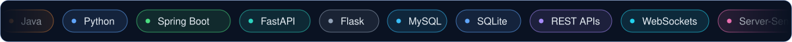

<table width="100%">
<tr>
<td width="22%" valign="middle"><b>Languages</b></td>
<td></td>
</tr>
<tr>
<td valign="middle"><b>Backend</b></td>
<td></td>
</tr>
<tr>
<td valign="middle"><b>Databases</b></td>
<td></td>
</tr>
<tr>
<td valign="middle"><b>Tools</b></td>
<td></td>
</tr>
<tr>
<td valign="middle"><b>Also used</b></td>
<td>REST APIs · WebSockets · Server-Sent Events · LLM integration · yt-dlp · FFmpeg · AES-256-GCM · HMAC-SHA256 · Web Crypto API</td>
</tr>
</table>



<table width="100%">
<tr>
<td width="62%" valign="top">

FastAPI backend for an LLM-integrated platform that helps students generate, explain, analyze, and securely execute code.

- REST APIs connecting the frontend, backend, and LLM inference layer
- Multiple LLMs integrated for code generation and analysis
- Sandboxed execution workflow for running untrusted student code
- Structured request validation and centralized error handling

</td>
<td width="38%" valign="top">

**Stack** 

**Status** 
Source is private under institutional research policy. Details in [Experience](#experience).

</td>
</tr>
</table>


<table width="100%">
<tr>
<td width="62%" valign="top">

Desktop app pairing a Java backend with **yt-dlp** and **FFmpeg** for resumable, high-quality media downloads with a real-time web UI.

- Live progress (speed, ETA, status) over Server-Sent Events
- Video up to 4K and MP3/FLAC audio extraction
- Metadata, thumbnail, and subtitle embedding with thumbnail caching
- Automatic retry on recoverable network failures, plus cancellation and history

**Architecture:** Java download engine, a controller layer coordinating yt-dlp/FFmpeg, and a lightweight web frontend consuming SSE streams.

</td>
<td width="38%" valign="top">

**Stack** 

**Repository** 
[VidForge](https://github.com/Ravitejeshnagasarapu/VidForge)

</td>
</tr>
</table>


<table width="100%">
<tr>
<td width="62%" valign="top">

A full compiler pipeline built as a systems and compiler-design project.

- Lexical analysis → recursive-descent parsing → schema-aware semantic validation → SQL generation
- `SELECT`, `JOIN`, `GROUP BY`, `ORDER BY`, aggregates, and `UPDATE`/`DELETE` with mandatory `WHERE` for safety
- Validation catches type mismatches and unknown tables or columns before execution
- Interactive frontend showing tokens, parse tree, generated SQL, and results

</td>
<td width="38%" valign="top">

**Stack** 

**Repository** 
[Controlled-Natural-Language-to-SQL-Compiler](https://github.com/Ravitejeshnagasarapu/Controlled-Natural-Language-to-SQL-Compiler)

</td>
</tr>
</table>


<table width="100%">
<tr>
<td width="62%" valign="top">

Lightweight authentication and encryption framework for resource-constrained IoT devices, with a built-in attack simulator to test the defenses.

- Nonce-based challenge-response using HMAC-SHA256; pre-shared keys never sent over the network
- End-to-end encryption with AES-256-GCM and per-message random IVs
- Real-time device communication over WebSockets (Flask-SocketIO)
- Replay, spoofing, and MITM simulations with a live security dashboard

**Architecture:** HTML/JS + Web Crypto API frontend, Flask/Flask-SocketIO backend, SQLite (WAL mode) persistence, WebSocket event layer.

</td>
<td width="38%" valign="top">

**Stack** 

**Repository** 
[Secure-IoT-Device-Authentication](https://github.com/Ravitejeshnagasarapu/Secure-IoT-Device-Authentication-Using-Lightweight-Cryptography)

</td>
</tr>
</table>



<table width="100%">
<tr>
<td width="100%" valign="top">

Guided by **Dr. Noor Mahammad SK**, Head of Department, CSE. Worked on **CodeTutor**, an AI-assisted programming education platform, centered on the FastAPI backend within a faculty-guided research setting.

- **Backend:** modular FastAPI services, RESTful APIs, structured validation, centralized error handling
- **AI integration:** multiple LLMs for code generation and automated code analysis; improved parsing of AI-generated responses
- **Secure execution:** sandboxed code-execution workflows for untrusted code
- **Engineering:** debugging, testing, feature implementation, and frontend-backend integration

</td>
</tr>
</table>



 

<picture>
  <source media="(prefers-color-scheme: dark)" srcset="./profile/snake-dark.svg">
  <source media="(prefers-color-scheme: light)" srcset="./profile/snake.svg">
  
</picture>


Open to **Java Backend Developer**, **Software Engineer**, and **Full Stack** roles, plus internships and open-source collaboration.

  

*I build backend systems meant to still be working, and still be readable, a year from now.*

